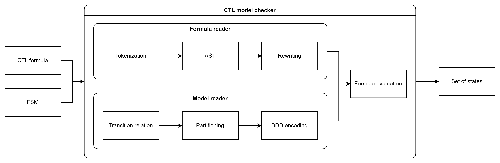

# 2023-03-07

## Research

This week we researched suggested paper: [CTL Model Checking Based on Forward State Traversal](https://citeseerx.ist.psu.edu/viewdoc/download?doi=10.1.1.469.1817&rep=rep1&type=pdf). Normaly temporal operators in a CTL formula are evaluated with backward state traversal. The paper describes a way to speed up CTL model checking by conwerting temporal operators into forward traversal operators. According to experiments on large models this method shows significant evaluation time improvement compared to backward state traversal when many temporal operators in a CTL formula are converted into forward traversal operators and transition relation is partitioned.

## Architecture

Our CTL model checker takes a CTL formula and a model (FSM) as input. After a series of transformations and evaluation we get the initial states of the FSM that satisfy the property expressed by the CTL formula.

## General plan

* Tokenization (1 week)
* AST (1 week)
* Rewriting (1 week)
* Transition relation (1 week)
* Partitioning (2 weeks)
* BDD encoding (2 weeks)
* Formula evaluation (2 weeks)

# 2023-03-14

## Research

* Original paper
* CTL grammar
* [argparse](https://github.com/p-ranav/argparse) - Used for parsing CLI arguments.
* [PEGTL](https://github.com/taocpp/PEGTL) - Used for parsing CTL formula, building AST and AST rewriting.

## Ojective

* Rewrite temporal operators in CTL formula to forward trawersal operators where it's possible

## Result

* We have MVP for building AST for CTL formulas

## Next goal

* Rewrite temporal operators in AST to forward trawersal operators

## Who did what

* Jing - Presentation and research
* Nikolay - Programming

# 2023-03-21

## Result

* We have reduced set of operators in AST to {true, false, ¬, ∧, EX, EU, EG} (Nikolay)

# 2023-03-28

## Research

* [sylvan](https://github.com/trolando/sylvan) - multi-core binary decision diagrams with native support for image and preimage operations

## Ojective

* Fully understand BBDs. In particular how to partition transition relation
* Discover the best way to input FSM into our model checker (there are many different formats)

## Result

* We have completed the CTL formula parser. Now it can reproduce example from the reference paper

## Next goal

* Decide on the file format with the description of FSM and how to read it

# 2023-04-04

## Research

* [fmt](https://github.com/fmtlib/fmt.git) - used for printing C++ std containers
* Papers about BDDs, logic and model checking
  * [Sylvan: multi-core framework for decision diagrams](https://link.springer.com/content/pdf/10.1007/s10009-016-0433-2.pdf?pdf=button)
  * [Generating BDDs for Symbolic Model Checking in CCS](https://link.springer.com/content/pdf/10.1007/3-540-55179-4_20.pdf)
  * [A Comparative Study of BDD Packages for Probabilistic Symbolic Model Checking](https://www.tvandijk.nl/pdf/2015setta.pdf)

## Result

* We have an MVP for the FSM parser and building the basic BDD structures

## Next goal

* Decide on the file format with the description of FSM and how to read it
* Understand how to partition transition relation

## Who did what

* Jing - Presentation and research
* Nikolay - Programming

# 2023-04-11

## Research

* Existing model checkers and their input formats
  * [NuSMV](https://nusmv.fbk.eu/)
  * [mCRL2](https://mcrl2.org/web/user_manual/language_reference/lts.html)

## Result

* FSM parser and required BDD structures
* Specification of the FSM input format:
  1. Number of states n, the first state is the initial state
  2. Next n lines: state, number of labels, list of labels
  3. Number of edges m
  4. Next n lines: state, state
* Example of FSM input format:

      3
      S0 2 begin start
      S1 0
      S2 1 finish
      2
      S0 S1
      S1 S2

* First steps for formula evaluation

## Next goal

* Finish the code for formula evaluation
